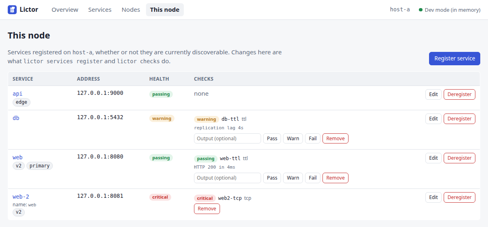

# Web UI

Every agent serves a web UI at `/ui` on its HTTP API address, by default
<http://127.0.0.1:7171/ui>. It's built into the `lictor` binary, so there's nothing else to
install or run.

## What it does

The UI covers everything the CLI can do with an agent:

| Page | |
|---|---|
| **Overview** | This node (id, addresses, lease, metadata), the agent (version, backend, catalog state), catalog totals, and the services that have warning or critical instances. |
| **Services** | Every service with live instances, with instance counts, a health bar and tags. Filter by name or tag, namespace and region. |
| **Services › name** | The live instances of a service, updated over a watch stream as they change. Filter by health, tags, node and scope. |
| **Nodes** | Live nodes with their addresses, service counts, agent version, metadata and remaining lease. |
| **This node** | The services registered on this agent, whether or not they are discoverable. Report TTL checks (pass, warn or fail, with output), remove checks, deregister services. |
| **Register / edit** | A form for every field of a [service definition](configuration.md#service-definitions), checks included, or a JSON editor that takes the same format as `lictor services register --file`. Editing starts from the stored definition (`GET /v1/agent/services/{id}/definition`) and saves by registering it again. |

Namespace and region filters are kept in the URL, so a filtered view can be bookmarked or shared.

## Access and security

- The UI uses the same [`/v1` API](http-api.md) as the CLI, from the browser. It can do only what
  that API allows.
- With `--token`, the UI asks for the token the first time the API refuses a request. It keeps the
  token for the browser tab, or in the browser's local storage if you tick "Remember on this
  device". The UI's own files (HTML, JavaScript, CSS) are served without the token: they contain no
  data.
- The agent listens on loopback by default. To reach the UI from another machine, prefer an SSH
  tunnel (`ssh -L 7171:127.0.0.1:7171 host`) to listening on a public address. If you do listen
  elsewhere, set `--token`.
- UI responses forbid framing by other sites (`X-Frame-Options: DENY`) and are never cached except
  for content-hashed assets.
- `--ui=false` (or `LICTOR_UI=false`) turns the UI off. `/ui` then returns 404 like any unknown path.

## Building

Release binaries, packages and container images always include the UI. A binary built with plain
`cargo build` includes it only if `ui/build/app` exists. Without it, `/ui` shows a short page saying
how to build it. See [development.md](development.md#web-ui) for working on the UI.
